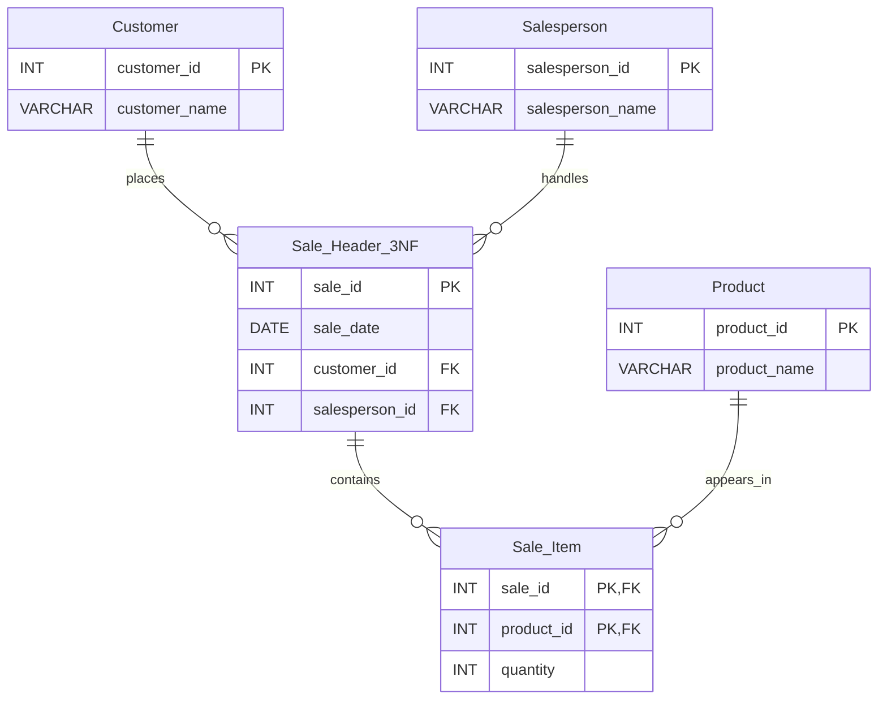

# Experiment 07 — Database Normalization (1NF, 2NF, 3NF & BCNF)

  
  
  
  

> **Aim:** Given a denormalized Sales table, identify functional dependencies and normalize the data step-by-step into **1NF, 2NF, 3NF and BCNF**. Verify **lossless join** and **dependency preservation** using SQL.

This experiment follows the supplied **Experiment 07 (Antrang Srivastava)** lab PDF. It retains the same `SalesDB`, six sample records, table names, normal forms and validation tasks. For a reusable GitHub example, the SQL additionally declares primary keys, foreign keys and a row-by-row reconstruction check.

## 📋 Experiment Overview

| Property | Details |
|---|---|
| Experiment | 07 |
| Database | `SalesDB` (independent of Experiments 03–06 / `CompanyDB`) |
| Initial table | `Sales` — 6 rows |
| Normalization | 1NF → 2NF → 3NF → BCNF |
| Final logical tables | `Customer`, `Salesperson`, `Product`, `Sale_Header_3NF`, `Sale_Item` |
| Platform | MySQL 8.0+ / MySQL Workbench |
| Skills | FDs, keys, partial & transitive dependencies, joins, referential integrity |

## 📁 Files

| File | Purpose |
|---|---|
| [`01_sales_database_and_1nf.sql`](./01_sales_database_and_1nf.sql) | Create and populate original Sales table; demonstrate 1NF and list FDs |
| [`02_second_normal_form.sql`](./02_second_normal_form.sql) | Split into `Sale_Header`, `Product`, `Sale_Item` to remove partial dependencies |
| [`03_third_normal_form_and_bcnf.sql`](./03_third_normal_form_and_bcnf.sql) | Create `Customer`, `Salesperson`, `Sale_Header_3NF` and explain BCNF |
| [`04_lossless_join_and_dependency_checks.sql`](./04_lossless_join_and_dependency_checks.sql) | Reconstruct records and check all five functional dependencies |
| `README.md` | Documentation, prerequisites, execution guide, expected outputs |

## 🎯 Learning Objectives

1. Recognize redundancy and anomalies in denormalized data.
2. Identify functional dependencies (FDs) and candidate keys.
3. Eliminate partial dependencies to obtain 2NF.
4. Eliminate transitive dependencies to obtain 3NF.
5. Assess BCNF using the identified FDs.
6. Demonstrate lossless reconstruction and dependency preservation.

## 🧠 Functional Dependencies

The candidate key for the original sale-line table is **`(sale_id, product_id)`**.

| Functional dependency | Meaning |
|---|---|
| `sale_id → sale_date, customer_id, salesperson_id` | Each sale has one date, customer and salesperson |
| `customer_id → customer_name` | Each customer ID determines a name |
| `salesperson_id → salesperson_name` | Each salesperson ID determines a name |
| `product_id → product_name` | Each product ID determines a product name |
| `(sale_id, product_id) → quantity` | Each sale/product pair determines its quantity |

### Normalization stages

- **1NF:** `Sales` already stores atomic values, with one product per sale-line row.
- **2NF:** Create `Sale_Header`, `Product`, and `Sale_Item` to remove partial dependencies on the composite key.
- **3NF:** Move customer and salesperson names out of `Sale_Header` into `Customer` and `Salesperson` and create `Sale_Header_3NF`.
- **BCNF:** In the five final logical relations, each stated FD's determinant is a candidate key in that relation. BCNF follows **under these stated FDs**.

> **Implementation note:** The repository retains intermediate 2NF `Sale_Header` as well as the final `Sale_Header_3NF` so you can inspect both stages. The final logical decomposition is the five 3NF/BCNF tables, not every physical demonstration table together.

## 🗺️ Final Data Relationships

## ▶️ How to Run in MySQL Workbench

**Prerequisites:** MySQL **8.0.16+** recommended (to enforce the `CHECK` constraints); a MySQL 8.x server and Workbench or another SQL client.

1. Download or clone this repository and open the `Experiment-07` folder.
2. Connect MySQL Workbench to a **practice server** with permission to create a database.
3. Open `01_sales_database_and_1nf.sql`; execute the **whole file** (Workbench: lightning-bolt button). It creates `SalesDB`, resets this experiment's objects, and inserts 6 sample rows.
4. Open and run `02_second_normal_form.sql`.
5. Open and run `03_third_normal_form_and_bcnf.sql`.
6. Open and run `04_lossless_join_and_dependency_checks.sql`.
7. Inspect the result grids and compare them with the expected results below.

**Important:** Use the order **01 → 02 → 03 → 04**. Files 02–04 depend on tables created by earlier files. To start over, execute file 01 and then rerun 02–04. Do **not** rerun files 02 or 03 in isolation after they have already created their tables.

**Warning:** File 01 uses `DROP TABLE IF EXISTS` for objects named in this experiment inside `SalesDB`, so it can overwrite existing practice work with the same names. Do not run it against a database containing important data.

**Online SQL editors:** If the editor forbids `CREATE DATABASE` or `USE`, select/create a permitted practice schema in the editor and omit those statements. Multi-statement execution, foreign keys and `CREATE VIEW` must be supported; some browser-based editors do not support all of these features.

## 📊 Expected Outputs (from the six-row sample)

### 1NF: Original Sales data

| sale_id | customer_name | salesperson_name | product_name | quantity |
|---|---|---|---|---|
| 1001 | Aarav | Rahul | Laptop | 1 |
| 1001 | Aarav | Rahul | Mouse | 2 |
| 1002 | Diya | Priya | Laptop | 1 |
| 1002 | Diya | Priya | Keyboard | 1 |
| 1003 | Aarav | Rahul | Mouse | 3 |
| 1003 | Aarav | Rahul | Monitor | 1 |

### 2NF: Intermediate table counts

| `Sale_Header` | `Product` | `Sale_Item` |
|---:|---:|---:|
| 3 | 4 | 6 |

### 3NF / BCNF: Final logical table counts

| `Customer` | `Salesperson` | `Product` | `Sale_Header_3NF` | `Sale_Item` |
|---:|---:|---:|---:|---:|
| 2 | 2 | 4 | 3 | 6 |

### Lossless reconstruction

The join of `Sale_Header_3NF`, `Customer`, `Salesperson`, `Sale_Item` and `Product` should recreate **all six original rows**.

| original_rows | reconstructed_rows | missing_rows | unexpected_rows |
|---:|---:|---:|---:|
| 6 | 6 | 0 | 0 |

The PDF compares row counts (6 vs 6). Script 04 goes further by comparing **all 9 columns in both directions**. Matching counts by themselves do not prove a lossless reconstruction; the additional comparison gives stronger evidence for this dataset.

### Dependency checks

For the sample data, the three queries checking `customer_id → customer_name`, `salesperson_id → salesperson_name`, and `product_id → product_name` should return **`name_count = 1` for every ID**. The remaining sale and sale-line dependencies are represented by their declared primary keys and displayed in the final two queries.

> **Note:** These are **expected results**, not a claim that the files were executed on your MySQL server. Sample data consistency checks and declared keys help demonstrate the intended FDs; checking a few rows alone is not a general proof of BCNF or dependency preservation for arbitrary data.

## ✅ Result

The denormalized Sales relation is decomposed into five final logical relations. The SQL tests demonstrate reconstruction of the six sale-line records and show consistency with the identified dependencies.

## 🏁 Conclusion

Normalization reduces redundancy and helps avoid insertion, update and deletion anomalies. The experiment demonstrates how 1NF, 2NF, 3NF and BCNF are derived from functional dependencies, and how joins and SQL constraints support checking the correctness of a decomposition.

## 👨‍💻 Student Information

| Field | Details |
|---|---|
| Name | **Antrang Srivastava** |
| Course / Section | **AI/ML-2A** |
| UID | **25LBCS3232** |
| Subject | **Database Management Systems (DBMS)** |

*Prepared as part of the DBMS practical laboratory coursework.*
