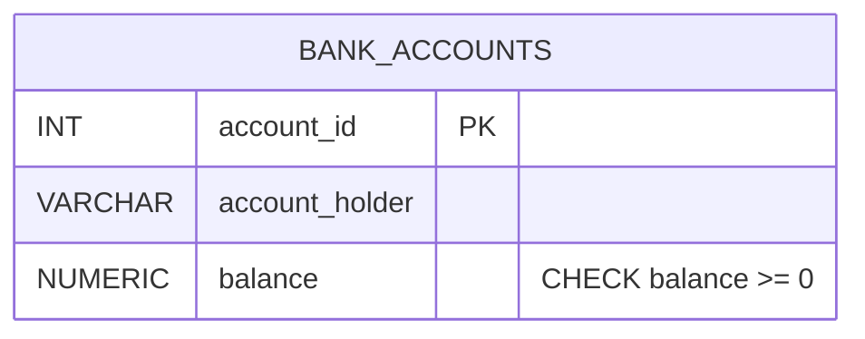

<div align="center">

# 🏦 Experiment 08 — Banking Transactions & Concurrency Control

**DBMS Laboratory · PostgreSQL · SQL Transactions**


</div>

> **Important:** This experiment uses **PostgreSQL**, as specified in the original laboratory PDF. Unlike Experiments 03–07, it does **not** depend on `CompanyDB` or MySQL. Run these examples using **pgAdmin 4** or PostgreSQL `psql` against a dedicated **practice database**.

## 🎯 Aim

To implement banking-style transactions using `BEGIN`, `COMMIT`, `ROLLBACK`, and `SAVEPOINT`, simulate partial failures, and demonstrate isolation levels and concurrency anomalies using two database sessions.

## ✅ Objectives

- Create a bank accounts table with a non-negative-balance constraint.
- Transfer funds using an atomic transaction with `BEGIN` and `COMMIT`.
- Undo an uncommitted withdrawal using `ROLLBACK`.
- Undo part of a transaction using `SAVEPOINT`.
- Explore `SERIALIZABLE` isolation.
- Use separate concurrent database sessions to examine dirty-read prevention and a non-repeatable read under `READ COMMITTED`.

## 📂 Files

| File | Description | How to run |
|---|---|---|
| [`01_create_bank_accounts.sql`](01_create_bank_accounts.sql) | Create `bank_accounts` and insert two sample records | Run first; resets demo table |
| [`02_commit_rollback_savepoint.sql`](02_commit_rollback_savepoint.sql) | Transfer, canceled withdrawal, and partial rollback | Run once after 01 |
| [`03_transaction_isolation.sql`](03_transaction_isolation.sql) | Inspect isolation level in a `SERIALIZABLE` transaction | Run after 01 |
| [`04_concurrency_session_1.sql`](04_concurrency_session_1.sql) | First connection's uncommitted update and final commit | Execute **in phases**, not all at once |
| [`05_concurrency_session_2.sql`](05_concurrency_session_2.sql) | Second connection's reads in one `READ COMMITTED` transaction | Execute **in phases**, not all at once |

## 🧩 Database Design



Sample records (immediately after file 01):

| account_id | account_holder | balance (₹) |
|---:|---|---:|
| 101 | Rahul | 10,000.00 |
| 102 | Aman | 5,000.00 |

**Constraint:** `CHECK (balance >= 0)` prevents a negative account balance. The demonstrations use a single table for clarity; they are teaching examples, not a complete production banking design.

## 📘 Concepts Covered

| Concept | Explanation |
|---|---|
| **Atomicity** | Transfer debit and credit either both commit or both roll back |
| **Consistency** | Constraints prevent invalid stored balances |
| **Isolation** | Concurrent operations are controlled through isolation levels |
| **Durability** | Committed database changes persist |
| **`BEGIN` / `COMMIT`** | Start and successfully complete a transaction |
| **`ROLLBACK`** | Undo all uncommitted work in a transaction |
| **`SAVEPOINT`** | Mark a location to support partial rollback |
| **`READ COMMITTED`** | A statement reads a snapshot of committed data; later statements can see newer commits |
| **`SERIALIZABLE`** | Strictest standard level, may abort conflicting concurrent transactions |

## ▶️ How to Run

**Prerequisites:** PostgreSQL installed and a connection through pgAdmin 4 or the `psql` CLI. Create a **practice database** (for example `dbms_experiment_08`) and connect to it before running the SQL files. `CREATE DATABASE` is intentionally not in the scripts because creating a PostgreSQL database depends on server permissions and the chosen connection.

### Using pgAdmin 4

1. Open **pgAdmin 4**, connect to your PostgreSQL server, and select a practice database.
2. Open **Query Tool** for the practice database.
3. Open `01_create_bank_accounts.sql` and execute it (F5).
4. Open `02_commit_rollback_savepoint.sql` and execute it **once**.
5. Open `03_transaction_isolation.sql` and execute it.
6. For concurrency, open **two independent Query Tool sessions/connections** and follow the interleaving below. Do **not** run both files all at once.

### Using `psql`

```bash
psql -d dbms_experiment_08 -f 01_create_bank_accounts.sql
psql -d dbms_experiment_08 -f 02_commit_rollback_savepoint.sql
psql -d dbms_experiment_08 -f 03_transaction_isolation.sql
```

If authentication requires it, specify your server host and username using `-h` and `-U`. For the two-session test, open **two interactive `psql` connections**, and execute one phase at a time.

> ⚠️ `01_create_bank_accounts.sql` drops and recreates `public.bank_accounts`, so it deletes any existing data in that practice table. Do not run this on a real bank or production database.

## 📊 Expected Outputs (when run in order)

| Stage | Rahul (101) | Aman (102) | Total |
|---|---:|---:|---:|
| After setup (`01`) | ₹10,000.00 | ₹5,000.00 | ₹15,000.00 |
| After transfer and `COMMIT` | ₹8,000.00 | ₹7,000.00 | ₹15,000.00 |
| During canceled withdrawal (before `ROLLBACK`) | ₹7,000.00 | ₹7,000.00 | ₹14,000.00 |
| After `ROLLBACK` | ₹8,000.00 | ₹7,000.00 | ₹15,000.00 |
| After `SAVEPOINT` example and final `COMMIT` | ₹7,500.00 | ₹7,500.00 | ₹15,000.00 |

For the `SAVEPOINT` section, the code first deducts ₹500, temporarily deducts an *additional* ₹1,000, then rolls back that extra debit. It credits ₹500 to Aman and commits only the intended ₹500 transfer.

### Note about the source PDF's error example

The original PDF attempts an extra **₹20,000 debit**, which violates the non-negative balance constraint and produces a PostgreSQL error. The runnable SQL file substitutes a **valid ₹1,000 debit followed by `ROLLBACK TO SAVEPOINT`** so that students can run the file straight through without an expected SQL error. The original invalid operation is documented in comments if an instructor specifically wants to demonstrate error recovery statement-by-statement.

### Note about independent screenshots

Some screenshots in the lab PDF show fresh balances of ₹10,000 / ₹5,000 at the rollback step. In this repository, files are executed **sequentially**, so the canceled withdrawal begins from the previously committed ₹8,000 / ₹7,000 state. Both approaches demonstrate `ROLLBACK`, but the sequential output above is the reproducible result for these scripts.

## 🪟 Two-Session Concurrency Demonstration

**Preparation:** Complete files 01 and 02. Then account `101` has ₹7,500. Use **two real connections** to the same database, not two editor tabs attached to a single connection. Keep transactions open until instructed.

| Order | Session | Action | Expected observation |
|---:|---|---|---|
| 1 | **Session 1** | In `04_concurrency_session_1.sql`, run `BEGIN` and `UPDATE ... SET balance = 9000` without committing | Change is uncommitted |
| 2 | **Session 2** | In `05_concurrency_session_2.sql`, run `BEGIN ISOLATION LEVEL READ COMMITTED` and the **first `SELECT`** | Sees ₹7,500, **not** the uncommitted ₹9,000 |
| 3 | **Session 1** | Run `COMMIT` | ₹9,000 becomes committed |
| 4 | **Session 2** | Still inside the **same transaction**, run the **second `SELECT`** | Sees ₹9,000, showing a non-repeatable read |
| 5 | **Session 2** | Run `COMMIT` | End second transaction |

**Interpretation:** PostgreSQL's `READ COMMITTED` level prevents dirty reads. Because it gets a new committed snapshot for each statement, the second read in the *same* transaction can differ after the other session commits. For this demonstration only, Session 1 uses a direct balance assignment to `9000` (not a transfer), so the total is **not** preserved; reset with files 01 then 02 before doing another banking transfer test.

**Common mistake:** If Session 2 commits between its reads, the experiment no longer demonstrates a non-repeatable read **within one transaction**. Keep Session 2 open until both reads are complete.

## 🔎 Verification Queries

After file 02:

```sql
SELECT account_id, account_holder, balance
FROM public.bank_accounts
ORDER BY account_id;

SELECT SUM(balance) AS total_balance
FROM public.bank_accounts;
```

Expected results: `101 → 7500.00`, `102 → 7500.00`, and `total_balance → 15000.00`. These are **expected** outputs; the scripts have not been certified by execution against your PostgreSQL instance.

## 📝 Result

Bank-account sample data and SQL examples demonstrate transaction commit, full and partial rollback, isolation levels, and transaction reads across two database connections.

## 🏁 Conclusion

Banking operations must protect data integrity while several users access the database. `COMMIT` makes valid changes durable, `ROLLBACK` cancels uncommitted changes, `SAVEPOINT` supports partial recovery, and isolation levels control what concurrent transactions can observe.

---

### 👨‍💻 Student Details

| Field | Value |
|---|---|
| **Name** | Antrang Srivastava |
| **Course / Section** | B.Tech CSE (AI & ML) — AI/ML-2A |
| **UID** | 25LBCS3232 |
| **Subject** | Database Management Systems (DBMS) |
| **Experiment** | 08 — Banking Transactions & Concurrency Control |

*Prepared for DBMS laboratory coursework. PostgreSQL output should be verified in your own environment.*
