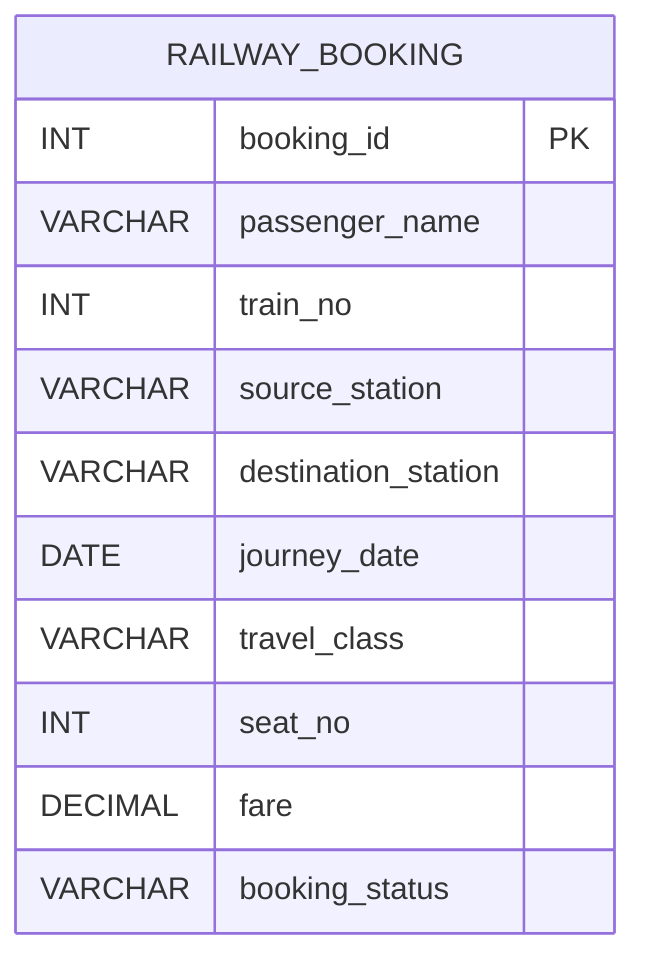

# Experiment 09 — Railway Booking: SQL Indexing & Query Performance

<p align="left">
  
  
  
  
</p>

> **DBMS Laboratory — Experiment 09**  
> **Student:** Antrang Srivastava  
> **Course / Section:** AI/ML-2A  
> **UID:** 25LBCS3232

## Aim

Create a Railway Booking table containing at least **5,000 records** (the sample generates **6,000**); benchmark searches before and after a single-column index and a composite index; and compare query execution plans using **`EXPLAIN`** and **`EXPLAIN ANALYZE`**.

This experiment closely follows the supplied **Experiment 9 PDF**. Three benchmark predicates, dataset formulas, index names and stages are retained. The SQL package adds reset-safe setup, data sanity checks, and a few clearly labelled supplementary comparisons.

## Objectives

- Generate 6,000 deterministic railway bookings using a recursive CTE.
- Observe table scans before adding secondary indexes.
- Add **`idx_train_no`** on `train_no` and inspect the optimizer's choice.
- Add **`idx_train_date`** on `(train_no, journey_date)` and compare plans.
- Understand the *leftmost-prefix* principle and the cost of indexes.
- Record measured results rather than assuming that an index is always selected.

## Tools & Requirements

- **MySQL 8.0.18+** (supports `EXPLAIN ANALYZE`; preferably a current MySQL 8.0/8.4 release).
- MySQL Workbench or the `mysql` command-line client.
- Permission to create a database/table and indexes and to set `cte_max_recursion_depth` for the session.
- **Important:** This is a **MySQL** experiment (unlike Experiment 08, which uses PostgreSQL).

## Repository Files

| File | Purpose |
|---|---|
| [`01_create_and_populate_railway_db.sql`](./01_create_and_populate_railway_db.sql) | Create `RailwayDB`, create/reset the table, generate 6,000 records, verify data. |
| [`02_baseline_without_indexes.sql`](./02_baseline_without_indexes.sql) | Stage 1: baseline plans with only the primary-key index. |
| [`03_single_column_index.sql`](./03_single_column_index.sql) | Stage 2: create `idx_train_no`, compare single-column and combined filters. |
| [`04_composite_index_and_comparison.sql`](./04_composite_index_and_comparison.sql) | Stage 3: create `idx_train_date`, study leftmost-prefix behavior, verify row counts. |
| [`README.md`](./README.md) | Documentation, reproducibility notes and comparison template. |

## Database Schema



**Primary key:** `booking_id`.  
**Indexes introduced by the experiment:** `idx_train_no(train_no)`, followed by `idx_train_date(train_no, journey_date)`.

## Sample Data

The SQL creates **6,000 synthetic bookings** with:

- 50 train numbers (`12000`–`12049`), 365 different journey dates, 10 source stations and 10 destination stations.
- 5 classes: `SL`, `3A`, `2A`, `1A`, `CC`.
- 3 statuses: `Confirmed`, `Waiting`, `Cancelled`.
- Names such as `Passenger_1` and deterministic fares, routes and seat numbers.

Example rows are produced by this exact dataset generator:

| booking_id | passenger_name | train_no | source_station | destination_station | journey_date | travel_class | seat_no | fare | booking_status |
|---:|---|---:|---|---|---|---|---:|---:|---|
| 1 | Passenger_1 | 12007 | Mumbai | Lucknow | 2026-01-02 | SL | 12 | 337.00 | Confirmed |
| 2 | Passenger_2 | 12014 | Kolkata | Bhopal | 2026-01-03 | SL | 23 | 374.00 | Confirmed |
| 3 | Passenger_3 | 12021 | Chennai | Delhi | 2026-01-04 | SL | 34 | 411.00 | Waiting |

> The above rows are **calculated from the input formulas**, not a claim of a recorded MySQL run. Full dataset and query counts should be verified by running the SQL.

## Benchmark Queries

```sql
-- Query 1: Single-column search
SELECT * FROM Railway_Booking WHERE train_no = 12038;

-- Query 2: Both columns of the composite index
SELECT * FROM Railway_Booking
WHERE train_no = 12038 AND journey_date = '2026-05-20';

-- Query 3: Non-leading composite-index column
SELECT * FROM Railway_Booking
WHERE journey_date = '2026-05-20';
```

Expected **matching row counts** based on the exact 6,000-row generation formula:

| Query | Expected matching rows |
|---|---:|
| Q1 — train `12038` | 120 |
| Q2 — train `12038` and `2026-05-20` | 2 |
| Q3 — date `2026-05-20` | 17 |

These are **data counts**, not measurements of rows physically examined by MySQL.

## How to Execute

### Option A: MySQL Workbench

1. Open MySQL Workbench and connect to your **practice** MySQL server.
2. Open `01_create_and_populate_railway_db.sql` and execute the entire file. Verify `total_records = 6000`.
3. Open and execute `02_baseline_without_indexes.sql`. **Record the results now, before creating any index.**
4. Open and execute `03_single_column_index.sql` once. Record Q1 and Q2 plans and timings.
5. Open and execute `04_composite_index_and_comparison.sql` once. Record Q1, Q2 and Q3 plans/timings.
6. Compare the results using the table below. Keep screenshots of the `EXPLAIN` and `EXPLAIN ANALYZE` output if your lab asks for proof.

**Order matters:** `01 → 02 → 03 → 04`. Do not run all scripts in random order: adding an index changes the baseline. If you need to start again, run **01** first (it recreates this experiment's table, removing the old indexes), then repeat all four scripts.

> **Reset warning:** `01` uses `DROP TABLE IF EXISTS Railway_Booking`. This deletes any existing contents of that named table in `RailwayDB`. Run only in a disposable practice database, not against real bookings.

### Option B: MySQL CLI

Run these four commands **in sequence** from the parent folder (they assume your `mysql` client is on PATH):

```bash
mysql -u root -p < Experiment-09/01_create_and_populate_railway_db.sql
mysql -u root -p < Experiment-09/02_baseline_without_indexes.sql
mysql -u root -p < Experiment-09/03_single_column_index.sql
mysql -u root -p < Experiment-09/04_composite_index_and_comparison.sql
```

If you are using a restricted online SQL sandbox that does not allow `CREATE DATABASE`, use an assigned practice database and omit the database-creation and `USE` statements. Some sandboxes also restrict recursion depth or `EXPLAIN ANALYZE`.

## Stage-by-Stage Explanation

### Stage 1 — Before secondary indexes

There is a primary-key index on `booking_id`, but no index on the benchmark filter columns. MySQL will generally choose a full table scan (`type = ALL`) for the train/date searches. `EXPLAIN ANALYZE` shows the **observed** execution pipeline and timings.

### Stage 2 — Index on `train_no`

```sql
CREATE INDEX idx_train_no ON Railway_Booking(train_no);
ANALYZE TABLE Railway_Booking;
```

This index *may* let MySQL locate the rows for a train instead of scanning the whole table. Q2 can use the same index to find a train and apply `journey_date` afterward. The selected access method depends on actual optimizer costs and available table statistics.

### Stage 3 — Composite index on `(train_no, journey_date)`

```sql
CREATE INDEX idx_train_date
ON Railway_Booking(train_no, journey_date);
ANALYZE TABLE Railway_Booking;
```

A multi-column index can support **Q2** with both equality predicates. Under the leftmost-prefix principle, this index also supports **Q1**, which filters by `train_no` alone. **Q3** filters only on the second column, `journey_date`, so it cannot use the ordinary leftmost-prefix lookup. Some MySQL configurations may consider a skip-scan or other access strategy: inspect `EXPLAIN` to see what actually happened.

## Comparison of Execution Plans

This is the **conceptual expectation**, not an automatically guaranteed or measured result.

| Property | Baseline | Single-column index | Composite index |
|---|---|---|---|
| Indexes present | `PRIMARY` | `PRIMARY`, `idx_train_no` | Both earlier indexes + `idx_train_date` |
| Q1 likely access | Table scan | Possible index lookup | Possible index lookup on leading column |
| Q2 likely access | Table scan | Train lookup + date filter | Combined train + date lookup |
| Q3 likely access | Table scan | Table scan | Usually scan / possibly skip-scan |
| General tradeoff | No secondary-index storage | Extra index storage and write overhead | Additional storage and maintenance overhead |

**Record your actual observations after execution:**

| Stage | Query | `EXPLAIN` type | Selected `key` | Estimated rows | `EXPLAIN ANALYZE` actual time (ms) |
|---|---|---|---|---:|---:|
| Before indexes | Q1 | _fill after run_ | _fill_ | — | — |
| Before indexes | Q2 | _fill after run_ | _fill_ | — | — |
| After single-column | Q1 | _fill after run_ | _fill_ | — | — |
| After single-column | Q2 | _fill after run_ | _fill_ | — | — |
| After composite | Q2 | _fill after run_ | _fill_ | — | — |
| After composite | Q3 | _fill after run_ | _fill_ | — | — |

> **Important interpretation of the supplied PDF:** Some screenshot plans on pages 5–9 still show `ALL` (a full scan) even after creating indexes, while its comparison table on page 9 describes `ref` as the expected improvement. This is not necessarily a SQL error—an optimizer can legitimately select a scan. The actual output from **your** MySQL instance is the evidence; do not report a `ref` lookup unless you observe it. Timings are too small and variable on 6,000 rows to promise a measurable speedup every time.

## Viva / Key Concepts

| Term | Meaning |
|---|---|
| **Index** | An auxiliary data structure that helps the engine find rows efficiently. |
| **Single-column index** | Index on one attribute such as `train_no`. |
| **Composite index** | Index on several attributes in a specified order. |
| **Leftmost prefix** | Composite index lookup is most directly useful when predicates constrain its leading columns. |
| **`EXPLAIN`** | Shows optimizer estimates and intended plan without executing the `SELECT` query. |
| **`EXPLAIN ANALYZE`** | Runs the query and reports actual execution information (and estimates). |
| **`ALL` vs `ref`** | `ALL` is a full scan; `ref` is a nonunique index lookup (in tabular `EXPLAIN`). |

## Result

The provided SQL is designed to build a 6,000-record Railway Booking dataset and demonstrate how adding single-column and composite indexes **can** change the query execution plan. The final comparisons should be recorded from actual `EXPLAIN` and `EXPLAIN ANALYZE` output.

## Conclusion

Indexes can reduce row lookups for selective searches, but they require additional disk space and increase maintenance work during `INSERT`, `UPDATE` and `DELETE`. Composite indexes work best when the search follows their column order. Index selection and performance should always be evaluated using measured query plans and not assumed in advance.

---

**Prepared by:** Antrang Srivastava | **AI/ML-2A** | **25LBCS3232**  
**Course:** Database Management Systems (DBMS) Laboratory
