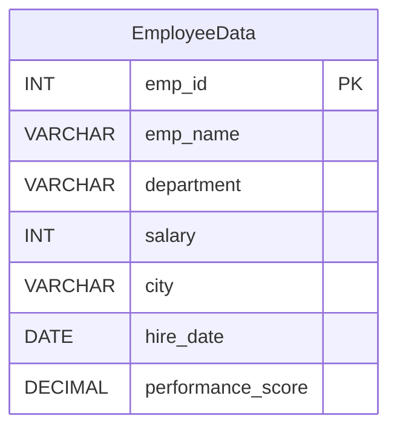

# Experiment 10 — SQL Query Optimization & Performance Analysis

> **DBMS Laboratory | MySQL 8.0.18+ | 10,000 synthetic employee rows**

[](https://dev.mysql.com/doc/)


## Student Information

| Field | Details |
| --- | --- |
| Name | **Antrang Srivastava** |
| Course / Section | **AI/ML-2A** |
| UID | **25LBCS3232** |
| Subject | Database Management Systems (DBMS) |

## Aim

Generate at least **10,000 rows**, identify five potentially slow queries, inspect their plans with `EXPLAIN`, improve them using indexes and rewrites, and compare **actual** query execution time before and after optimization.

## Objectives

- Build the `QueryLabDB.EmployeeData` dataset with 10,000 reproducible records.
- Identify five common SQL performance pitfalls.
- Compare query access paths with `EXPLAIN` and execution timings with `EXPLAIN ANALYZE`.
- Test single-column and composite indexes and compare equivalent rewrites where applicable.
- Explain when an index or rewrite is **not guaranteed** to improve performance.

## Database Schema

`QueryLabDB` contains one table, `EmployeeData`.



Synthetic values cycle across five departments (`IT`, `HR`, `Finance`, `Sales`, `Operations`), six cities, a generated salary range, dates, and performance scores. These are demo records, not real personnel records.

## Folder Structure

```text
Experiment-10/
├── 01_create_and_populate_employee_data.sql
├── 02_baseline_five_queries.sql
├── 03_optimized_five_queries.sql
├── 04_verify_results.sql
└── README.md
```

| File | What it does |
| --- | --- |
| `01_create_and_populate_employee_data.sql` | Recreates the sample table, inserts 10,000 rows, and checks count. |
| `02_baseline_five_queries.sql` | Captures `EXPLAIN` and `EXPLAIN ANALYZE` for all five **before** versions, without added indexes. |
| `03_optimized_five_queries.sql` | Adds useful indexes and runs five optimized/reframed versions. |
| `04_verify_results.sql` | Checks row count and result equivalence, explicitly flagging Query 2's changed semantics. |

## How to Run (MySQL Workbench or MySQL CLI)

1. Use a **practice MySQL 8.0.18+ server**. The files use MySQL syntax (`ELT`, `DATE_ADD`, `cte_max_recursion_depth`, `EXPLAIN ANALYZE`).
2. Execute `01_create_and_populate_employee_data.sql`. **Warning:** its `DROP TABLE IF EXISTS EmployeeData` deletes that practice table if it already exists.
3. Verify that `SELECT COUNT(*) FROM QueryLabDB.EmployeeData;` returns **10,000**.
4. Run `02_baseline_five_queries.sql` **before** creating any new index, and record each baseline plan and `EXPLAIN ANALYZE` actual time.
5. Run `03_optimized_five_queries.sql` **once**, record the five optimized plans and times.
6. Run `04_verify_results.sql` to verify counts and exact row membership for equivalent rewrites.
7. To repeat the experiment fairly, **rerun file 01** (resets the table and indexes), then repeat 02 → 03 → 04. Compare multiple trials because caching, load, and optimizer choices affect timings.

**CLI example** (after extracting ZIP and opening the folder):

```bash
mysql -u root -p < 01_create_and_populate_employee_data.sql
mysql -u root -p < 02_baseline_five_queries.sql
mysql -u root -p < 03_optimized_five_queries.sql
mysql -u root -p < 04_verify_results.sql
```

`EXPLAIN` describes the estimated plan; `EXPLAIN ANALYZE` **runs the SELECT** and reports actual timings and row counts. Do not mistake a screenshot tool's total response latency for MySQL query execution time.

## Five Optimization Cases

| Case | Original | Improved variant | Notes |
| --- | --- | --- | --- |
| **1. Function on date** | `YEAR(hire_date) = 2022` | Date range + `idx_hire_date` | Same result set; range predicate is index-friendly. |
| **2. Leading wildcard** | `emp_name LIKE '%999%'` | Literal prefix `LIKE 'Employee!_999%' ESCAPE '!'` + `idx_emp_name` | **Not equivalent**: substring vs prefix. Only change when the search requirement is prefix matching. |
| **3. Unindexed filter** | `department = 'Finance'` | Add `idx_department` | Same query; five possible department values mean selectivity is low, so the optimizer may still scan. |
| **4. Correlated average** | Per-employee correlated subquery | Grouped department averages + JOIN + `(department, salary)` index | Equivalent logical condition. Optimizer may already transform/cache the original. |
| **5. OR across columns** | `department = 'IT' OR city = 'Lucknow'` | `UNION` of indexed queries + `idx_city` | Same rows without duplicates; **UNION might be slower** owing to deduplication. |

The PDF illustrates these five cases. The GitHub scripts add consistent before/after analysis for every case and verification of equivalence when the rewrite is supposed to preserve results.

### Important SQL LIKE nuance

In SQL `LIKE`, the underscore (`_`) matches **any single character**. The pattern `LIKE 'Employee_999%'` from the source PDF is not an exact literal underscore match. The GitHub script uses `LIKE 'Employee!_999%' ESCAPE '!'` for a literal underscore; the overall change from a substring search to prefix search is intentional and **may exclude matches**.

### Expected Dataset Checks

- `total_rows`: **10000**
- `Finance` employees: **2000** (synthetic generator cycles 5 departments evenly)
- Run the verification script to inspect other counts and confirm that Query 4 and Query 5 have **0 missing and 0 extra IDs**.
- Actual time, plan, scanned-row estimates, and index usage **depend on your MySQL version/server/environment**. Never substitute invented timings.

## Performance Comparison (Fill After Running)

Capture time from the relevant `EXPLAIN ANALYZE` plan; include units and whether timings come from first or repeated runs.

| Query | Baseline access / time | Optimized access / time | Observed result |
| --- | --- | --- | --- |
| 1 — Date / YEAR | _fill from run_ | _fill from run_ | _fill_ |
| 2 — Substring vs prefix | _fill from run_ | _fill from run_ | **Different filters; timing comparison is illustrative only** |
| 3 — Department | _fill from run_ | _fill from run_ | _fill_ |
| 4 — Above-average salary | _fill from run_ | _fill from run_ | _fill_ |
| 5 — OR vs UNION | _fill from run_ | _fill from run_ | _fill_ |

A change to indexed access is **possible, not guaranteed**. Smaller tables, unselective predicates, statistics, and optimizer choices can make scans faster than using an index.

## Observations and Result

This experiment demonstrates generating a 10,000-row table, examining five SQL query patterns and applying indexing and query-rewriting alternatives. The SQL includes checks for equivalent results and a reproducible before/after measurement procedure. **This repository does not claim that the scripts have already been run on a particular MySQL server or that performance improved by a fixed amount.**

## Conclusion

Query optimization aims to minimize unnecessary work through suitable predicates, indexes, and execution strategies. `EXPLAIN` and `EXPLAIN ANALYZE` should guide decisions: indexed queries are not inherently faster in every case, and a rewrite must preserve the intended search semantics.

---

**Author:** Antrang Srivastava · AI/ML-2A · 25LBCS3232  
*Prepared as part of DBMS lab coursework.*
